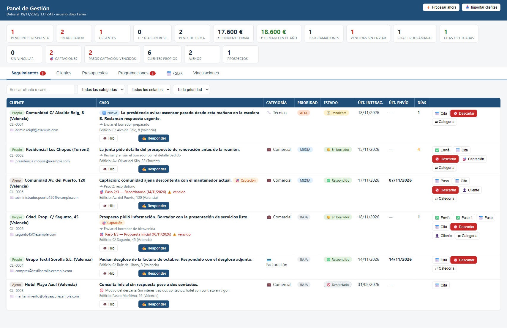
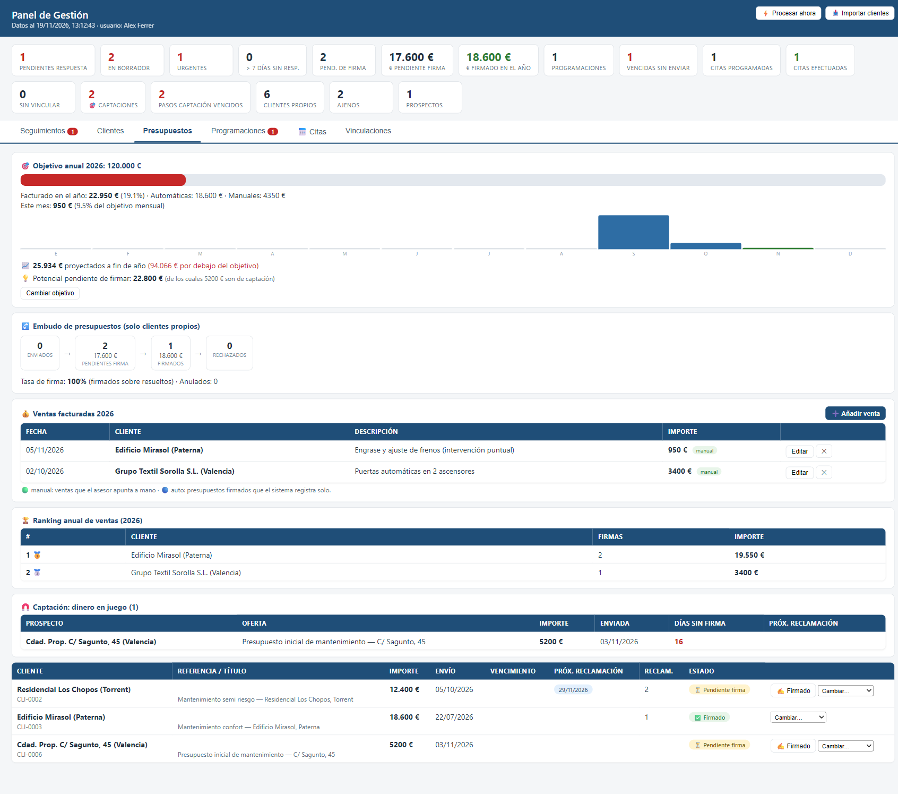
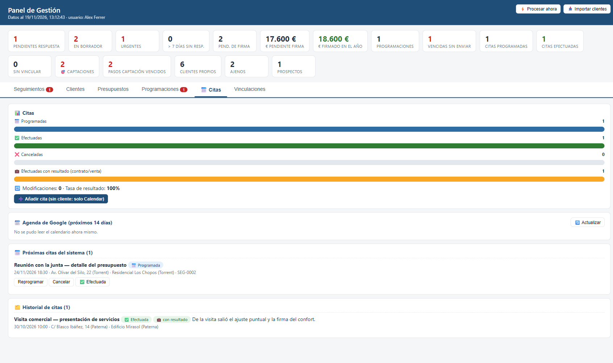
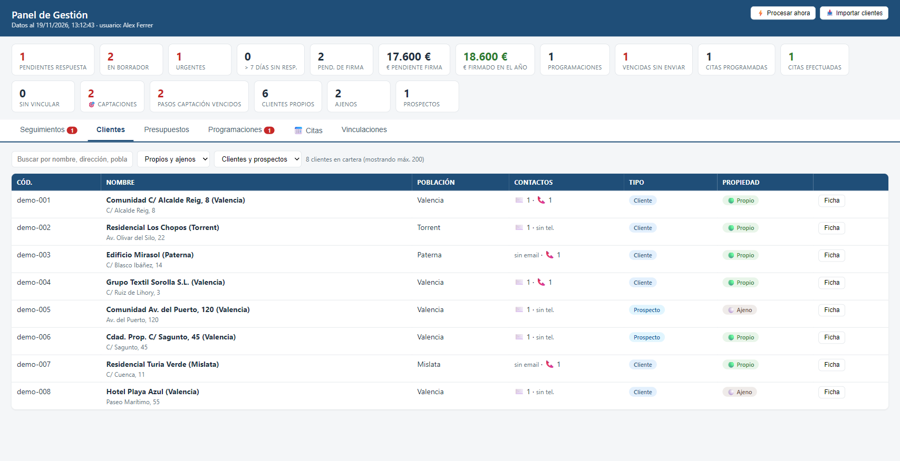

# Commercial Assistant Agent — Gestor comercial con agente de IA

[](https://m8ven.ai/mcp/soldiersnake/commercial-assistant-agent?s=readme)

**Agente de IA que gestiona el día a día de un asesor comercial: lee el correo, clasifica cada entrante, prepara borradores de respuesta, hace seguimiento de presupuestos, captaciones y citas — y nunca envía un mail solo.**

> 🧭 *"Agente asistente* (agéntico) que se conecta a tu Gmail y a tu calendario mediante MCP, decide qué hacer con cada correo y te deja todo listo para revisar: borradores, seguimientos, avisos y un panel de gestión local.*

*English version below · [Versión en inglés más abajo](#english)*

---

## 📋 Índice

1. [El problema que resuelve](#-el-problema-que-resuelve)
2. [Qué hace](#-qué-hace)
3. [Arquitectura](#-arquitectura)
4. [Tecnologías](#%EF%B8%8F-tecnologías)
5. [Decisiones de diseño](#-decisiones-de-diseño)
6. [IA sin coste](#-ia-sin-coste)
7. [Privacidad por diseño](#-privacidad-por-diseño)
8. [Empezar en 10 minutos](#-empezar-en-10-minutos)
9. [Estructura del proyecto](#-estructura-del-proyecto)

---

## 🎯 El problema que resuelve

Un asesor comercial de una empresa de servicios (en este caso, mantenimiento de ascensores) vive del correo: clientes que escriben sobre averías, presupuestos pendientes de firmar, comunidades que piden presupuestos nuevos, facturas, trabajos ejecutados... **y no hay CRM que valga** porque el correo ya es el "sistema" de todos.

Este proyecto convierte un agente de IA en el ayudante de ese asesor:

- **El correo es la entrada.** El agente lee el buzón autorizado (solo lectura) y decide qué es cada mensaje: empresa, técnico, facturación, trabajos pendientes o comercial.
- **La respuesta es un borrador.** El agente escribe la respuesta en el hilo original y la deja como *borrador* en Gmail. El asesor la revisa, la ajusta y **la envía él**.
- **Nada se pierde.** Cada caso queda registrado en una memoria local: estado, historial, próximas acciones, registro mensual.

Construido y usado en producción diaria para gestionar la cartera de clientes de un asesor comercial real.

## ⚙️ Qué hace

| Función | Detalle |
|---|---|
| 📥 **Clasificación de entrantes** | Cada mail nuevo se clasifica en: Empresa (corporativo) / Técnico / Facturación / Trabajos pendientes / Comercial, con verificación de dominio contra `config.json` |
| ✍️ **Borradores de respuesta** | Respuesta personalizada en el hilo de origen + bloque fijo de contactos por departamento (según plantillas editables) |
| 💰 **Presupuestos** | Ventana de firma configurable (por defecto 3 meses antes del vencimiento), reclamación periódica con contador, cierre al confirmar "Firmado" a mano |
| 🎯 **Captaciones** | Plan de 3 toques con un prospecto (propuesta → recordatorio → cierre), cadencia configurable |
| 📅 **Citas** | Creación/reprogramación con aviso de solapamiento contra la agenda real de Google Calendar |
| 📊 **Objetivo comercial** | Presupuestos firmados vs objetivo anual (reparto mensual automático) |
| 🖥️ **Panel local** | Dashboard HTML servido en `localhost:8765`: pendientes, borradores, fichas de cliente, presupuestos, citas y económico |
| 🤖 **Asistente conversacional** | Modo "pregúntame lo que sea" sobre la cartera: *"¿qué pendientes tengo?"*, *"apunta esta venta"*, *"agenda visita el jueves a las 10"* |
| ⏰ **Corridas programadas** | Procesado automático a primera hora y por la tarde (tareas programadas de Windows), más corrida manual "Procesar ahora" |

### 📸 Capturas (con datos ficticios)

| Panel de seguimientos | Presupuestos y objetivo anual |
|---|---|
|  |  |

| Citas | Clientes |
|---|---|
|  |  |

> ¿Quieres verlo tú mismo sin datos reales? `python scripts/demo_data.py` genera un dataset **ficticio** (comunidades, presupuestos, citas...) y el panel arranca con él.

## 🏗️ Arquitectura

```text
┌──────────────────────────────────────────────────────────────────────┐
│  RUNTIME AGÉNTICO (intercambiable: OpenCode, Gemini CLI, ...)        │
│  ├── Lee docs/agente/instrucciones.md (el "cerebro" del agente)      │
│  └── Usa las herramientas MCP ────────────────────────┐              │
└───────────────────────────────────────────────────────│──────────────┘
                                                        │ MCP (stdio)
                    ┌───────────────────────────────────▼────────────┐
   Gmail/Calendar ◀─┤  mcp-gmail/servidor_mcp.py (FastMCP)           │
   (OAuth, token    │  ├── Gmail: LECTURA + BORRADORES (nunca envía) │
   local, nunca     │  └── Calendar: crear/listar/cancelar citas     │
   contraseñas)     └────────────────────────────────────────────────┘
                                                        ▲
┌──────────────────────┐   ┌───────────────────────────┴──────────────┐
│ entrada/             │   │  dashboard/  (localhost:8765)            │
│  Excel de clientes ─▶│   │  HTML + JS vanilla, sin dependencias     │
│  importar_clientes   │   │  Panel de gestión con acciones reales    │
└──────────────────────┘   │  (recategorizar, marcar enviado, ...)    │
                           └──────────────────────────────────────────┘
                                        │ lee/escribe
                    ┌───────────────────▼──────────────────────────────┐
                    │  datos/  — LA MEMORIA (100 % local, JSON/MD)     │
                    │  maestro_clientes · seguimientos · presupuestos  │
                    │  citas · config · meses/AAAA-MM.md · plantillas/ │
                    └──────────────────────────────────────────────────┘
                                        │
                    ┌───────────────────▼───────────────┐
                    │  scripts/sync.py → Excel de gestión│
                    │  (vista generada, nunca a mano)    │
                    └───────────────────────────────────┘
```

**Flujo de una corrida (7:00 / 16:00 / "Procesar ahora"):**

1. El runtime agéntico abre sesión con `docs/agente/prompt_corrida.txt`.
2. Consulta los mails nuevos vía MCP Gmail y los compara con la memoria (`datos/`).
3. Clasifica, genera borradores, crea/actualiza seguimientos y programaciones.
4. Escribe el resultado en `datos/` y deja un resumen para el asesor.
5. El panel muestra el estado y permite las acciones manuales (que tienen prioridad sobre lo que diga el correo).

## 🛠️ Tecnologías

| Capa | Tecnología | Por qué |
|---|---|---|
| Lenguaje | **Python 3.12+** | Ecosistema de APIs de Google, sin compilación |
| Agente MCP | **FastMCP** | Servidor MCP local en ~400 líneas; expone Gmail/Calendar como herramientas del agente |
| APIs de Google | **Gmail API + Calendar API** (OAuth 2.0) | Scopes mínimos: `gmail.readonly` + `gmail.compose` + `calendar.events` |
| Runtime agéntico | **OpenCode** o **Gemini CLI** | El modelo de IA es configurable: ver [IA sin coste](#-ia-sin-coste) |
| Dashboard | **HTML/CSS/JS vanilla** + servidor Python estándar | Cero build, cero dependencias de frontend; sirve también de API del panel |
| Datos | **JSON + Markdown** (ficheros locales) | Memoria legible por humanos, versionable fuera del git, migrable a BD en el futuro |
| Excel | **openpyxl** | Import del Excel de clientes y generación de la vista de gestión |
| Tests | **pytest** | Importador y reglas de negocio cubiertos |
| Automatización | PowerShell + Tareas programadas de Windows | Corridas diarias sin servicios en la nube |

## 💡 Decisiones de diseño

1. **El sistema nunca envía un correo.** El MCP de Gmail pide solo `gmail.readonly` y `gmail.compose`. Sin `gmail.send`, la app *no puede* enviar aunque el agente alucine. El asesor envía siempre a mano desde Gmail. (Es la regla de oro nº 1 del proyecto.)
2. **La memoria vive en `datos/`, no en una base de datos.** Todo pasa por los módulos centralizados de `scripts/` (un único punto de acceso), así que la futura migración a BD es barata. Y al ser ficheros locales, los datos del asesor están en su PC, no en la nube.
3. **Las vistas no se editan a mano.** El Excel y el dashboard son *salidas* generadas desde la memoria; editarlas a mano rompería la coherencia del sistema.
4. **Acciones del panel > mails nuevos.** Si el asesor corrige algo en el panel (recategorizar, marcar enviado), esa decisión manda sobre lo que el agente deduzca del correo.
5. **Nunca se borra: se archiva.** Los datos descartados van a `datos/archivo/` con su historial; nada desaparece.
6. **Config editable, código neutro.** Nombre del asesor, firma, empresa, dominios y contactos de cada departamento viven en `datos/config.json` (excluido del git). Cualquier persona clona el repo, copia `datos/config.example.json` y adapta el sistema a su negocio en un fichero.
7. **El "cerebro" del agente es documentación, no código.** El comportamiento del agente (cómo clasifica, qué tono usa, cuándo no responder) vive en `docs/agente/instrucciones.md` — un markdown editable, que además aprende de las correcciones del asesor (`datos/memoria/lecciones.md`).

## 🆓 IA sin coste

Este sistema está pensado para quien **no puede pagar una suscripción de IA**. El runtime agéntico es intercambiable y hay caminos 100 % gratuitos:

| Opción | Qué necesitas | Límite gratuito | Dificultad |
|---|---|---|---|
| **🥇 Gemini CLI (recomendada)** | Solo tu cuenta de Google personal | **1.000 solicitudes/día** · 60/min · contexto 1M | Mínima |
| OpenCode + clave Gemini API | Clave gratuita de Google AI Studio | ~250 solicitudes/día | Fácil |
| OpenCode + GitHub Copilot Free | Cuenta de GitHub | Cuota gratuita de Copilot Free | Fácil |
| Ollama (100 % local) | Un PC con suficiente RAM/VRAM | Sin límite, sin internet | Media |

👉 Pasos exactos (con el bloque de configuración MCP listo para copiar): **[docs/CONFIGURACION.md](docs/CONFIGURACION.md)**.

## 🔒 Privacidad por diseño

- **No vemos tu contraseña. Nunca.** El login es OAuth 2.0 estándar: la contraseña se escribe **solo en la web de Google, en tu navegador**. La app recibe únicamente un *token* de permiso, guardado en tu disco (`mcp-gmail/token.json`, excluido del git) y revocable en un clic desde tu cuenta de Google → Seguridad → Aplicaciones con acceso.
- **Permisos mínimos y verificables**: la app pide leer tu correo, crear borradores y gestionar tu calendario. Pide expresamente **no** poder enviar correos.
- **Tu información vive en tu disco**: clientes, seguimientos, presupuestos y el aprendizaje del agente son ficheros JSON/Markdown en `datos/`. No hay base de datos remota, no hay servidores propios, no hay telemetría. `datos/` está excluido del git: los datos reales nunca se publican.
- **Datos de ejemplo para el portfolio**: todas las capturas de este README usan datos ficticios.

## 🚀 Empezar en 10 minutos

1. **Instala el proyecto** (una vez, necesitas [Python 3.12+](https://www.python.org/downloads/)): abre un terminal en la carpeta del proyecto y ejecuta
   ```powershell
   python -m venv .venv
   .venv\Scripts\pip install -r requirements.txt
   ```
   Crea la carpeta `.venv` con Python y sus librerías (el equivalente a `npm install`). Los `.bat` la usan: sin ella, Windows dirá que no encuentra `.venv\Scripts\python.exe`.
2. **Abre el panel**: doble clic en `Panel de Gestion.bat` → `http://127.0.0.1:8765`.
3. **Elige cómo empezar** en la pantalla de bienvenida:
   - 🧪 **Probar con datos de ejemplo**: una cartera ficticia para explorar el panel sin conectar nada.
   - 🚀 **Empezar con mis datos**: un asistente visual te guía paso a paso para **conectar tu Gmail y tu calendario** (crear tu credencial de Google y dar permiso, sin consola), **tus datos y tu empresa**, **tu lista de clientes** (con plantilla Excel descargable) y **el asistente de IA**. Puedes volver a él cuando quieras con el botón ⚙️ *Configuración*.
4. **Prueba una corrida**: botón ⚡ *Procesar ahora* del panel (o `Procesar Ahora.bat`) y mira cómo clasifica y prepara borradores.

Guía detallada (también para hacerlo a mano, sin el asistente): **[docs/CONFIGURACION.md](docs/CONFIGURACION.md)**.

## 📂 Estructura del proyecto

```text
AGENTS.md            ← reglas de desarrollo para agentes/humano
README.md            ← este fichero
docs/
  PLAN.md            ← plan maestro (fases, decisiones, esquemas)
  CONFIGURACION.md   ← guía de puesta en marcha (IA + Gmail + calendario)
  agente/            ← el "cerebro" del agente (instrucciones, prompts)
entrada/             ← el asesor suelta aquí su Excel de clientes
  procesados/        ← ficheros ya importados (con fecha)
datos/               ← LA MEMORIA (fuente de verdad, no va al git)
  config.example.json ← plantilla de configuración personal
  maestro_clientes.json · seguimientos.json · presupuestos.json
  meses/AAAA-MM.md   ← registro cronológico por mes
  memoria/lecciones.md ← aprendizaje del agente (estilo del asesor)
  plantillas/*.md    ← escritos estándar editables
scripts/             ← Python/PowerShell: sync, importador, corridas
dashboard/           ← mini-app local (HTML + servidor Python)
mcp-gmail/           ← MCP: SOLO lectura + borradores (nunca enviar)
tests/               ← pruebas
```

---

<a id="english"></a>

# Commercial Assistant Agent (English)

**An AI agent that handles the day-to-day work of a commercial advisor: it reads the email inbox, classifies every incoming message, prepares reply drafts, tracks quotes, prospecting and appointments — and never sends an email by itself.**

> An *agentic* assistant that connects to your Gmail and calendar via MCP, decides what to do with each email, and leaves everything ready for review: drafts, follow-ups, alerts, and a local management dashboard.

## 🎯 The problem it solves

A commercial advisor at a field-services company (in this case, elevator maintenance) lives in their inbox: clients reporting breakdowns, quotes waiting for signature, communities requesting new quotes, invoices, completed work… and no CRM fits, because email already *is* everyone's "system".

This project turns an AI agent into that advisor's assistant:

- **Email is the input.** The agent reads the authorized mailbox (read-only) and decides what each message is: corporate, technical, billing, pending work, or commercial.
- **The reply is a draft.** The agent writes the reply on the original thread and leaves it as a *draft* in Gmail. The advisor reviews, adjusts and **sends it personally**.
- **Nothing gets lost.** Every case is recorded in a local memory: state, history, next actions, monthly log.

Built and used daily in production to manage a real commercial advisor's client portfolio.

## ⚙️ Features

| Feature | Detail |
|---|---|
| 📥 **Incoming classification** | Every new email is classified: Corporate / Technical / Billing / Pending work / Commercial, with domain verification against `config.json` |
| ✍️ **Reply drafts** | Personalized reply on the original thread + fixed per-department contact block (from editable templates) |
| 💰 **Quotes** | Configurable signing window (default 3 months before expiry), periodic follow-up with counter, closes on manual "Signed" confirmation |
| 🎯 **Prospecting** | 3-touch plan per prospect (proposal → reminder → closing), configurable cadence |
| 📅 **Appointments** | Create/reschedule with overlap warning against the real Google Calendar agenda |
| 📊 **Sales target** | Signed quotes vs annual target (automatic monthly split) |
| 🖥️ **Local dashboard** | Vanilla HTML dashboard on `localhost:8765`: pending items, drafts, client cards, quotes, appointments, economics |
| 🤖 **Conversational assistant** | "Ask me anything" mode about the portfolio: *"what do I have pending?"*, *"log this sale"*, *"schedule a visit Thursday at 10"* |
| ⏰ **Scheduled runs** | Automatic morning and evening processing (Windows scheduled tasks), plus a manual "Process now" run |

### 📸 Screenshots (fictional data)

| Follow-ups dashboard | Quotes & annual target |
|---|---|
|  |  |

| Appointments | Clients |
|---|---|
|  |  |

> Want to try it yourself without real data? `python scripts/demo_data.py` generates a **fictional** dataset (communities, quotes, appointments…) and the dashboard boots with it.

## 🏗️ Architecture

```text
┌──────────────────────────────────────────────────────────────────────┐
│  AGENTIC RUNTIME (swappable: OpenCode, Gemini CLI, ...)              │
│  ├── Reads docs/agente/instrucciones.md (the agent's "brain")        │
│  └── Uses the MCP tools ───────────────────────────────┐             │
└────────────────────────────────────────────────────────│─────────────┘
                                                         │ MCP (stdio)
                    ┌────────────────────────────────────▼───────────┐
   Gmail/Calendar ◀─┤  mcp-gmail/servidor_mcp.py (FastMCP)           │
   (OAuth, local    │  ├── Gmail: READ + DRAFTS (never sends)        │
   token, never     │  └── Calendar: create/list/cancel appointments │
   passwords)       └────────────────────────────────────────────────┘
                                                         ▲
┌──────────────────────┐   ┌────────────────────────────┴─────────────┐
│ entrada/             │   │  dashboard/  (localhost:8765)            │
│  Client Excel     ──▶│   │  HTML + vanilla JS, zero frontend deps   │
│  importar_clientes   │   │  Dashboard with real actions             │
└──────────────────────┘   │  (recategorize, mark sent, ...)          │
                           └──────────────────────────────────────────┘
                                        │ reads/writes
                    ┌───────────────────▼──────────────────────────────┐
                    │  datos/  — THE MEMORY (100% local, JSON/MD)      │
                    │  clients · follow-ups · quotes · config · logs   │
                    │  monthly logs · editable email templates         │
                    └──────────────────────────────────────────────────┘
                                        │
                    ┌───────────────────▼───────────────┐
                    │  scripts/sync.py → Excel view      │
                    │  (generated output, never hand-edited) │
                    └───────────────────────────────────┘
```

**A scheduled run (7:00 / 16:00 / "Process now"):**

1. The agentic runtime starts a session with `docs/agente/prompt_corrida.txt`.
2. It fetches new emails via the Gmail MCP and compares them against the local memory (`datos/`).
3. It classifies, generates drafts, creates/updates follow-ups and schedules.
4. It writes results to `datos/` and leaves a summary for the advisor.
5. The dashboard shows the state and allows manual actions (which take priority over what the agent inferred from email).

## 🛠️ Tech stack

| Layer | Technology | Why |
|---|---|---|
| Language | **Python 3.12+** | Solid ecosystem for Google APIs, no compilation |
| Agentic MCP | **FastMCP** | Local MCP server in ~400 lines; exposes Gmail/Calendar as agent tools |
| Google APIs | **Gmail API + Calendar API** (OAuth 2.0) | Minimal scopes: `gmail.readonly` + `gmail.compose` + `calendar.events` |
| Agentic runtime | **OpenCode** or **Gemini CLI** | The AI model is configurable — see [Zero-cost AI](#-zero-cost-ai) |
| Dashboard | **Vanilla HTML/CSS/JS** + Python stdlib server | No build step, no frontend dependencies; doubles as the panel's API |
| Data | **JSON + Markdown** (local files) | Human-readable memory, kept out of git, easy future migration to a DB |
| Excel | **openpyxl** | Client Excel import and management-view generation |
| Tests | **pytest** | Importer and business rules covered |
| Automation | PowerShell + Windows scheduled tasks | Daily runs with zero cloud services |

## 💡 Design decisions

1. **The system never sends an email.** The Gmail MCP only requests `gmail.readonly` and `gmail.compose`. Without `gmail.send`, the app *cannot* send even if the agent hallucinates. The advisor always sends manually from Gmail. (Golden rule #1.)
2. **The memory lives in `datos/`, not in a database.** All writes go through centralized modules in `scripts/` (single access point), so a future DB migration is cheap. And since it's local files, the advisor's data stays on their PC, not in the cloud.
3. **Views are never hand-edited.** The Excel and dashboard are *outputs* generated from the memory; hand-editing them would break system coherence.
4. **Dashboard actions > new emails.** If the advisor corrects something in the panel (recategorize, mark as sent), that decision overrides whatever the agent inferred from email.
5. **Never delete: archive.** Discarded data goes to `datos/archivo/` with its history; nothing disappears.
6. **Editable config, neutral code.** The advisor's name, signature, company, domains and department contacts live in `datos/config.json` (git-ignored). Anyone can clone the repo, copy `datos/config.example.json`, and adapt the system to their own business in a single file.
7. **The agent's "brain" is documentation, not code.** Agent behavior (how it classifies, which tone to use, when not to reply) lives in `docs/agente/instrucciones.md` — an editable markdown that also learns from the advisor's corrections (`datos/memoria/lecciones.md`).

## 🆓 Zero-cost AI

This system is designed for people who **cannot pay for an AI subscription**. The agentic runtime is swappable, and there are fully free paths:

| Option | What you need | Free limit | Difficulty |
|---|---|---|---|
| **🥇 Gemini CLI (recommended)** | Just your personal Google account | **1,000 requests/day** · 60/min · 1M context | Minimal |
| OpenCode + Gemini API key | Free Google AI Studio key | ~250 requests/day | Easy |
| OpenCode + GitHub Copilot Free | A GitHub account | Copilot Free quota | Easy |
| Ollama (100% local) | A PC with enough RAM/VRAM | Unlimited, offline | Medium |

👉 Exact steps (with the MCP config block ready to copy): **[docs/CONFIGURACION.md](docs/CONFIGURACION.md)**.

## 🔒 Privacy by design

- **We never see your password.** Login is standard OAuth 2.0: the password is typed **only on Google's website, in your browser**. The app receives only a permission *token*, stored on your disk (`mcp-gmail/token.json`, git-ignored) and revocable in one click from your Google account → Security → Third-party access.
- **Minimum, verifiable permissions**: the app asks to read your mail, create drafts and manage your calendar. It deliberately does *not* ask for the ability to send mail.
- **Your information lives on your disk**: clients, follow-ups, quotes and the agent's learning are JSON/Markdown files under `datos/`. No remote database, no servers of ours, no telemetry. `datos/` is git-ignored: real data is never published.
- **Sample data for the portfolio**: every screenshot in this README uses fictional data.

## 🚀 Get started in 10 minutes

1. **Install the project** (once, requires [Python 3.12+](https://www.python.org/downloads/)): open a terminal in the project folder and run
   ```powershell
   python -m venv .venv
   .venv\Scripts\pip install -r requirements.txt
   ```
   This creates the `.venv` folder with Python and its libraries (the equivalent of `npm install`). The `.bat` launchers rely on it: without it, Windows reports it cannot find `.venv\Scripts\python.exe`.
2. **Open the dashboard**: double-click `Panel de Gestion.bat` → `http://127.0.0.1:8765`.
3. **Choose how to start** on the welcome screen:
   - 🧪 **Try it with sample data**: a fictional portfolio to explore the dashboard without connecting anything.
   - 🚀 **Start with my data**: a visual step-by-step wizard to **connect Gmail and Calendar** (create your Google credential and grant access, no console needed), **your details and company**, **your client list** (with a downloadable Excel template) and **the AI assistant**. Reopen it any time with the ⚙️ *Configuración* button.
4. **Try a run**: the ⚡ *Procesar ahora* button in the dashboard (or `Procesar Ahora.bat`) and watch it classify and prepare drafts.

Detailed guide (including the manual, wizard-free setup): **[docs/CONFIGURACION.md](docs/CONFIGURACION.md)**.

---

*Hecho con OpenCode + Gemini · Built with OpenCode + Gemini*
